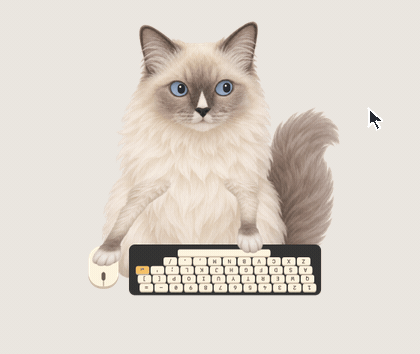
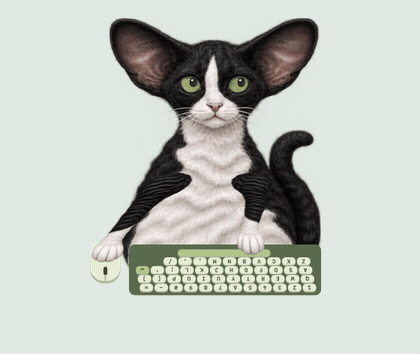

# Sneakpaw

A small menu-bar cat for macOS 14 and later. Move your pointer and the cat follows it with its eyes while sliding a tiny mouse across the desk. Start typing and both paws tap the keyboard as its gaze drops to the keys. Pause or move the pointer and it looks back. Click the cat to choose a breed. Double-click the cat to make its pupils widen and the keyboard and mouse bounce. Pick the cat up and it swings with your hand, carrying its mouse and your chosen keyboard.

Choose from thirteen cats and seven keyboards. The pet works on its own. The optional local webhook lets a script or coding agent display a short message above its head.

| Follow the pointer | Type with both paws | Pick up and swing |
| :---: | :---: | :---: |
|  |  |  |

## Installation

Sneakpaw currently builds from source on macOS 14 or later. For a ready-to-install download, watch [GitHub Releases](https://github.com/ribincao/sneakpaw/releases) for the first packaged version.

### Build from source

With Xcode installed, clone the repository and build a locally signed copy on your Mac.

```sh
git clone https://github.com/ribincao/sneakpaw.git
cd sneakpaw
xcodebuild -scheme Sneakpaw -configuration Debug -derivedDataPath build \
  CODE_SIGN_STYLE=Manual DEVELOPMENT_TEAM= CODE_SIGN_IDENTITY=- build
open build/Build/Products/Debug/Sneakpaw.app
```

Choose **Cat** or **Keyboard** in the paw menu to switch independently. Ragdoll and Buttermilk are the defaults. Each choice is saved immediately.

Mouse tracking works at launch. Select **Mimic Typing** to opt into system-wide key animation. Grant Input Monitoring in System Settings and restart if requested. Key labels exist only in memory for the animation. System-protected input can suspend monitoring. The app persists the window origin and the opt-in setting.

The command above uses ad hoc signing. macOS may ask for Input Monitoring again after a rebuild. For regular development, open `Sneakpaw.xcodeproj` in Xcode and select your own team under **Signing & Capabilities**. Keep the signing identity and bundle identifier consistent across updates.

## Optional bubble webhook

While Sneakpaw is running, a local process can send a JSON event to `POST /v1/events` on `127.0.0.1`. Read the port and bearer token from the pairing file **for each delivery**. Both can change after a restart. The historical filename `codex-pair.json` is shared by all senders. Keep the token on your Mac.

### Version 1 schema

| Field | Type | Meaning |
| --- | --- | --- |
| `version` | integer | Required. Use `1`. |
| `source` | string | Required. Sender name used in the title, 1–64 characters, with visible text and no control characters. Built-in Codex uses `codex`. |
| `type` | string | Required. Use `turn.completed` for a reply or `connection.test` to verify delivery. Both display a bubble. |
| `event_id` | string | Required. 1–256 characters. Assign one ID per event and reuse it for retries. The receiver remembers the last 128 deliveries across sources and deduplicates by source and ID. |
| `preview` | string | Required. Up to 512 characters. The bubble previews two lines for six seconds. Hover to read the supplied preview and pause the timer; leaving restores the compact bubble and resumes the countdown. An empty string displays “Reply ready”. |
| `chat_name` | string or null | Optional. Use the chat title, or supply the project name when the title is unavailable. Omit it to display only the source. |

### Try a bubble

Run this on the same Mac with Sneakpaw open. The example uses Python 3 and the standard library.

```python
import json
import uuid
from pathlib import Path
from urllib.request import Request, urlopen

pair_file = Path.home() / (
    "Library/Containers/com.caolibin.sneakpaw/Data/Library/"
    "Application Support/Sneakpaw/codex-pair.json"
)
pair = json.loads(pair_file.read_text())
event = {
    "version": 1,
    "source": "My Agent",
    "type": "connection.test",
    "event_id": str(uuid.uuid4()),
    "chat_name": "Sneakpaw",
    "preview": "Your cat is listening.",
}
request = Request(
    f"http://127.0.0.1:{pair['port']}/v1/events",
    data=json.dumps(event).encode(),
    headers={"Authorization": "Bearer " + pair["token"], "Content-Type": "application/json"},
)
with urlopen(request, timeout=2) as response:
    print(response.status)
```

Expect HTTP 204 and a bubble titled **My Agent · Sneakpaw**. Retried duplicates also receive 204. HTTP 401 means the bearer token was rejected. HTTP 400 means the request framing or event was invalid. Send HTTP/1.1 with a Content-Length and a JSON body of at most 8 KiB.

### Ask your agent to connect

Copy this into a local agent that supports reply-completion hooks. Codex has a built-in setup helper below. Other agents need their own hook or script.

> Connect your local reply-completion hook to Sneakpaw using the version 1 webhook documented here. Use your name as the source, the chat title or project name as chat_name, and a short excerpt of your final visible reply as preview. Read the pairing file at delivery time without printing the token. Preserve my existing hooks and notification settings. When the cat is offline, finish the turn normally. First send a connection.test, then verify one real turn.completed reply. If your client lacks a completion hook, tell me before changing anything.

### Built-in Codex setup

Open Settings → Agent Notifications → Connect, copy the instructions, and send them to local Codex. The bundled installer requires Python 3. It adds an independent Stop command to the user's hooks.json and can be run again. Review the new command in the Codex CLI with /hooks. Start a fresh turn after trusting it. Preview Bubble tests the display; Connected records delivery of a turn.completed event.

The sandboxed app binds only to IPv4 loopback on an ephemeral port. Its pairing file in Application Support is private to the user. The hook posts at most 180 characters of the final reply and exits promptly if Sneakpaw is unavailable. The app retains the last delivery time, not message history. To disconnect, disable the Sneakpaw Stop command in /hooks.

## License

[MIT License](LICENSE)
